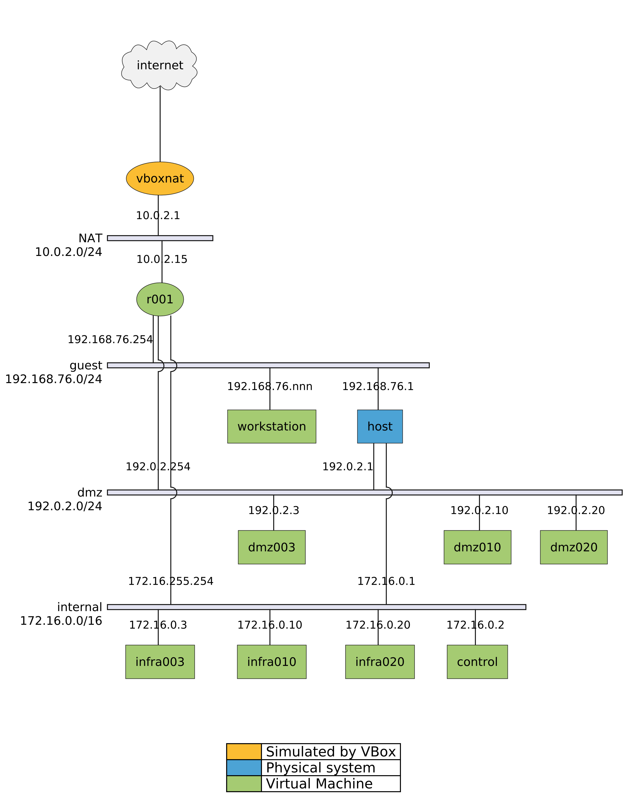
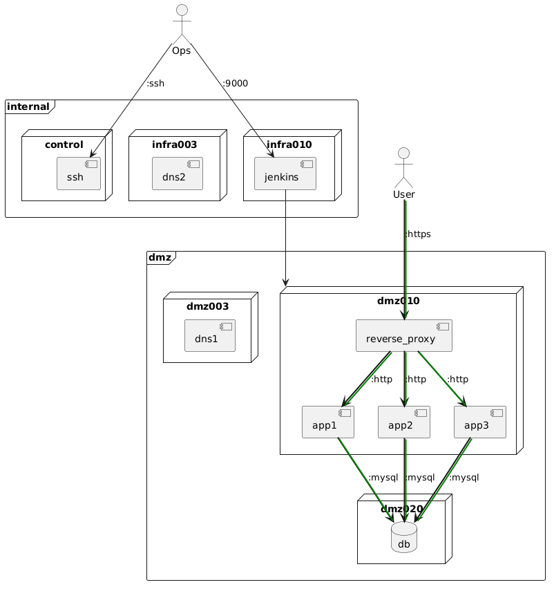

# Lab 2: Configuration Management with Ansible

The goal of this assignment is to set up multi-VM infrastructure for a web application where High Availability (HA) is a requirement.

> ❗ Sometimes students install the `vagrant-vbguest` plugin that is supposed to automatically check whether VirtualBox Guest additions are up-to-date and to install an update if they aren't. However, the base boxes we use don't have the prerequisites (C-compiler, etc.) so this will fail, resulting in the guest additions no longer working. Biggest problem with this is that the /vagrant directory is no longer mounted. In short: you should never install the `vagrant-vbguest` plugin while working on this assignment

## Learning goals

- You can automate the setup of network services with a configuration management system (Ansible)
- You can install and configure reproducible virtual environments (Infrastructure as Code) with suitable tools for the automation of the entire lifecycle of a VM

## Assessment criteria (L2)

To meet the standard, show that the following criteria are met:

- [ ] Show that you can reconstruct the entire setup (except the VMs for the router and workstation) from scratch by executing the command `vagrant up`, without any manual configuration afterwards.
- [ ] Show that when connecting a workstation VM to the "guest" network, it:
    - gets correct IP settings;
    - can access the local website in a webbrowser using the hostname, not the IP address (also verify that you have installed a custom SSL certificate);
    - has internet access.
- [ ] Demonstrate routing in your network by pinging several hosts from the workstation VM, e.g. the webserver in the DMZ (should be reachable), the build server in the internal network (should NOT be reachable), and a host on the Internet.
- [ ] Demonstrate how name resolution works.
    - The workstation should be able to resolve the host name of the webserver in the DMZ and host names of the public Internet. Other host names should not be resolvable.
    - In the internal network, **all** host names should be resolvable, including host names of the public Internet.
- [ ] Demonstrate that you understand how your setup works beyond copying the assignment instructions to a GenAI and pasting the results to the terminal or your lab report
- [ ] Show your lab report and cheat sheet! It should contain screenshots of consecutive steps and console output of commands you used.

In order to exceed expectations, implement one or more of the suggested extensions given throughout this assignment (indicated with this symbol: ⭐), or come up with your own.

## Overview of the network topology

As domain name for the environment, we will use `infra.lan`. The environment consists of the subnets enumerated below. Each of the three subnets will correspond to a VirtualBox host-only network that will be connected by a virtual router that you will set up as well.

- `dmz`:
    - Subnet 192.0.2.0/24,
    - For customer facing services, e.g. web server and Authoritative DNS
    - In a production environment, these services would typically be hosted in a public cloud
- `internal`:
    - Subnet 172.16.0.0/16
    - For internal services, e.g. build server, monitoring, Ansible control host, etc.
    - In production, these services would remain on-premise or in a private cloud. Remote access to these services would be provided through a VPN connection (that we will not implement in this lab).
- `guest`:
    - Subnet 192.168.76.0/24
    - Simulates an on-premise network for end-users or visitors. A workstation on this network should be able to access the public website hosted on the DMZ network, but not the internal services.

The image below shows the network topology of the finished lab environment (after Lab 3). The router is connected to all three networks and provides routing between them. It also provides (caching) DNS and DHCP services for the VMs in the guest network. Your physical system (in blue), is also connected to all networks through the VirtualBox host-only network adapters. It always has the first IP address in each subnet, as per VirtualBox convention. The router has the last IP address in each subnet.



### Services overview

The [deployment diagram](https://en.wikipedia.org/wiki/Deployment_diagram) below shows which services are running on which hosts.



The two large rectangular areas labeled "internal" and "dns" are two subnets in the environment. Subnet "guest" is not shown, as it does not contain any services that need to be displayed in the diagram. You can imagine that the "User" actor accesses the public website from a workstation that is connected to the "guest" network. The "Ops" actor represents the system administrator who manages the environment from the Ansible control node.

The boxes labeled `infra010`, `dmz010`, etc. represent the VMs in the environment. Gray rectangles represent services that are running on the VMs (and, consequently, are listening on a server socket). The arrows denote client-server relationships between actors and/or services and point *from* a client *to* a server.

For clarity, some of the client/server arrows are not shown in the diagram. For example, the control node will communicate with *all* managed nodes over SSH. Also, the DNS service in the DMZ can be queried by all VMs in the environment, the one in the internal network only by the VMs in that network.

### Virtual machine overview

| Hostname   | Alias | IP Address     | Description                           |
| :--------- | :---- | :------------- | :------------------------------------ |
| `r001`     | --    | 192.0.2.254    | Router (with caching DNS and DHCP)    |
|            |       | 172.16.255.254 |                                       |
|            |       | 192.168.76.254 |                                       |
| `dmz003`   | ns    | 192.0.2.3      | Authoritative DNS server              |
| `dmz010`   | www   | 192.0.2.10     | Docker host, hosts the public website |
| `dmz020`   | db    | 192.0.2.20     | Database server                       |
| `control`  | --    | 172.16.0.2     | Ansible control node                  |
| `infra003` | ins   | 172.16.0.3     | Stealth DNS server                    |
| `infra010` | build | 172.16.0.10    | Build server                          |
| `infra020` | mon   | 172.16.0.20    | Monitoring server                     |

VMs don't get a name that is directly related to their function, but rather a generic name that is related to their subnet. This is to make it easier to re-purpose a hostname for a different function later on. Hostnames of VMs at cloud providers are also typically generic and not directly related to their function.

The router can provide DNS and DHCP services and will resolve descriptive hostnames to the correct IP addresses, so that users and administrators don't have to remember the mapping between hostnames and services.

## 2.1. Set up the control node

Go to the `labenv/` directory and start the control node with `vagrant up control`. This is the machine from which you will run Ansible to configure the other VMs in the environment. It has already configured the Jenkins build server from the previous assignment.

Check that you can log in to the VM with `vagrant ssh control`.

- What is/are the IP addresses of this VM?
- Check the VirtualBox network adapters of the VM and see if you can match the IP addresses with the VirtualBox adapter.
- Which Linux distribution are we running (command `lsb_release -a` or `cat /etc/redhat-release`)? Find some information about this distro!
- What version of the Linux kernel is installed (`uname -a`)?
- What version of Ansible is installed?
- Check the contents of the direcory `/vagrant/`.

    The contents of this directory correspond with the `labenv/` directory on your physical system. In fact, it is a shared directory, so changes you make on your physical system are immediately visible on the VM and vice versa.

You can start using the control node to execute Ansible commands. Ensure that you're in the correct directory (`/vagrant/ansible/`) before you do!

Feel free to improve the configuration of the control node to your liking. To make your changes persistent, update the Bash script found in `labenv/scripts/control.sh`. This script is executed every time the VM is created, or when you run `vagrant provision control`. For example, you can install additional useful commands or Ansible dependencies, customize the bashrc file with command aliases or a fancy prompt, run the Ansible playbooks to configure the managed hosts, etc.

## 2.2. Adding a managed node

Next, we are going to set up our first **managed node**, i.e. a host that is managed by Ansible.

Add a new VM named `dmz020` (which will become our database server) to the Vagrant environment by editing the `vagrant-hosts.yml` file in the `labenv` directory.

```yaml
- name: dmz020
  box: bento/debian-13
  ip: 192.0.2.20
```

You are free to choose a different base box. We recommend the ones from the [Bento](https://app.vagrantup.com/bento) project, as they work well and are well maintained. Suggestions besides `bento/debian-13` are: `bento/almalinux-10` or`bento/ubuntu-26.04`. Even a mix of different base boxes is allowed. This will require that your Ansible playbooks are generic enough to work with different Linux distributions.

If your laptop has limited resources (CPU, RAM), you can limit the number of CPUs and the amount of RAM assigned to the VM by adding something like:

```yaml
  cpus: 1       # only use 1 CPU core
  memory: 1024  # RAM in MB
```

Some operating systems or services need more resources than others, so increase these values if necessary. Unfortunately, recent versions of some Linux distributions have become rather resource hungry and they may not run well with too little memory (which is why you need plenty of RAM on your computer!). If you run into problems, try if increasing the amount of RAM and/or CPU cores assigned to the VM helps.

Your control node should always be the last VM defined in `vagrant-hosts.yml`. The reason will become apparent at the final stage of this assignment.

Check whether the new VM is recognized by Vagrant by running `vagrant status` and look for the host name in the command output. If it is, start the VM with `vagrant up dmz020`. Check that you can log in to the VM with `vagrant ssh dmz020`.

In order to communicate with managed nodes, you need to provide Ansible with a list of hosts. This list is called an [inventory](https://docs.ansible.com/ansible/latest/user_guide/intro_inventory.html). The inventory can be a simple list of host names, but it can also contain additional information like the host's IP address (if it is not known by DNS), the user account to log in with, etc. The YAML file `labenv/ansible/inventory.yml` already contains an initial inventory that defines the Jenkins build server as a managed node.

Add an entry for the new VM to this inventory file like so:

```yaml
# ... lines omitted ...
  children:
    infra_hosts:
      hosts:
        infra010:
          ansible_host: 172.16.0.10
    dmz_hosts:
      hosts:
        dmz020:
          ansible_host: 192.0.2.20
```

The first line shown here with `children:` is the start of a section that defines groups of hosts. All VMs in the internal network will be added to the group `infra_hosts`, those in the DMZ to the group `dmz_hosts`. Later, we'll add another group for the router VM.

The `vars:` section (not shown here, but you can take a look at the existing inventory file) contains a list of variables that apply to all hosts in the inventory.

- The variable `ansible_user` specifies the user that Ansible will use to log in to the managed nodes and run commands,
- and `ansible_ssh_password` the password that will be used to log in.
- `ansible_ssh_host_key_checking` is a boolean value that specifies whether Ansible should check fingerprint of the SSH keys of the managed nodes. Turning it off is convenient in this environment, as normally, you would need to manually allow SSH to connect to the managed nodes. Don't do this in a production environment, though!
- We set the variable `ansible_python_interpreter` manually to avoid an annoying warning (try commenting the line out to see what happens).
- The variable `ansible_become`, finally, specifies that Ansible should use `sudo` to run commands with administrator privileges.

The `hosts` section contains a list of hosts that Ansible can manage. You will extend this list later. The `ansible_host` variable specifies the IP address of the host. This is necessary because the host name `dmz020` is not known outside the VM: there is no DNS server available (yet!) that knows how to map host name `dmz020` to the specified IP address.

To check whether Ansible can communicate with the VM, execute the following command from within the control node, in the `ansible/` directory:

```console
vagrant@control:~$ cd /vagrant/ansible/
vagrant@control:/vagrant/ansible$ ansible -i inventory.yml -m ping dmz020
```

If this works, you can have Ansible lookup all kinds of information about the managed node with the `setup` module:

```console
vagrant@control:/vagrant/ansible$ ansible -i inventory.yml -m setup dmz020
```

The result will be a long list of facts about the managed node. You can also limit the output to a specific fact by specifying the fact name with the `-a` option:

```console
vagrant@control:/vagrant/ansible$ ansible -i inventory.yml -m setup -a "filter=ansible_distribution*" dmz020
```

**Remark:** From here on out, you can assume that the command `vagrant` should always be executed from your physical system, in your preferred shell (Bash, Git Bash, PowerShell, ...) and from the directory `labenv/` (containing the file `Vagrantfile`). All Ansible commands should be executed from within the control node, from the directory `/vagrant/ansible/` (containing the `inventory.yml` file).

## 2.3 Running the site playbook against a managed node

Configuring a managed node with Ansible is done by executing a [playbook](https://docs.ansible.com/ansible/latest/playbook_guide/index.html). A playbook is a [YAML](https://yaml.org) file that contains a list of tasks that should be executed on the target system to bring it to the desired state. In our setup, the main playbook is called `site.yml`. It is all but empty now, but you will add to it later.

Edit `ansible/site.yml` and add the following:

```yaml
- name: "Configure dmz020"  # Each task should have a name
  hosts: dmz020             # Indicates hosts this applies to (host or group name)
  tasks:                    # Enumerate tasks to be executed on the target system
    - name: "Show a message from the managed node"
      ansible.builtin.debug:
        msg: "Hello from {{ ansible_facts.hostname }}!"
```

You can now run this playbook (against `dmz020`) using the command `ansible-playbook -i inventory.yml --limit dmz020 site.yml`. You should see the following output from `dmz020`:

```console
TASK [Show a message from the managed node] ****************************************************************************************************************************************
ok: [dmz020] => {
    "msg": "Hello from dmz020!"
}
```

## 2.4 Applying a role to a managed node

The easiest way to configure a VM is to apply an existing [role](https://docs.ansible.com/ansible/latest/user_guide/playbooks_reuse_roles.html). A role is a playbook that is written to be reusable. It contains a general description of the desired state of the target system, and you can customize it for your specific case by setting *role variables*. The website [Ansible Galaxy](https://galaxy.ansible.com/) is a public repository of Ansible roles contributed by the Ansible community. You can search for roles that are suitable for your needs, and use them in your own playbooks.

The `dmz020` VM will be configured as a (MariaDB) database server, so take a look if you find a suitable role on Ansible Galaxy. We suggest to start with `fauust.mariadb`, as it has the most downloads and was last updated relatively recently. For your own setup, you are free to experiment with other roles.

In order to use this role, you should first install it with the command:

```console
vagrant@control:/vagrant/ansible$ ansible-galaxy install fauust.mariadb
```

This will download the role and put it in the correct directory (which one?) so Ansible can make use of it. You will add more roles later, so it's a good idea to have a way install them all at once. This can be done by creating a file `ansible/requirements.yml` with the following contents:

```yaml
---
roles:
  - name: fauust.mariadb
```

You can install all roles listed in this file with the command:

```console
vagrant@control:/vagrant/ansible$ ansible-galaxy install -r requirements.yml
```

Add all roles you will use in this lab assignment to this file. You can also add this command to the `labenv/scripts/control.sh` script, so the roles are installed automatically when you create the control node!

Now add the role to the configuration of the `dmz020` host in `site.yml`:

```yaml
- name: "Configure dmz020"
  hosts: dmz020
  roles:
    - fauust.mariadb
  tasks:
    - name: "Show a message from the managed node"
      ansible.builtin.debug:
        msg: "Hello from {{ ansible_facts.hostname }}!"
```

Next, run the `site.yml` playbook against `dmz020` with command:

```console
vagrant@control:/vagrant/ansible$ ansible-playbook -i inventory.yml --limit dmz020 site.yml
```

Watch the output and see what happens, specifically, which changes were made to the system. What runs first, the role or the task? If the playbook ran without errors, run it again and check that this time, no changes were applied. What is the name of this property that after the first run, an operation does not change the target system anymore?

The role `fauust.mariadb` performs several operations to configure the managed node to some desired state. It is possible to customize this desired state by setting so-called role variables. Well written roles have good documentation that explains which variables are available and how to use them. The documentation for `fauust.mariadb` can be found on [Ansible Galaxy](https://galaxy.ansible.com/ui/standalone/roles/fauust/mariadb/documentation/) (click on the README button) or in the role's [public GitHub repository](https://github.com/fauust/ansible-role-mariadb).

Variables can be set in a playbook itself, but this would quickly make it very hard to read. It is best practice to initialise variables in a separate file. Ansible looks for variables in some default locations, either in a subdirectory `ansible/group_vars/`  or `ansible/host_vars/`. Host variables will only be visible inside that specific host. For `dmz020`, this host variable file should be called `ansible/host_vars/dmz020.yml`. Hosts can be ordered into groups, but at this time, this is outside the scope of this assignment. However, there is one special group, called `all`, that contains all hosts that can be managed by Ansible. This variable file should be called `ansible/group_vars/all.yml`.

Since the configuration of the database is specific to the `dmz020` host, we will define the role variables in the host variable file `ansible/host_vars/dmz020.yml`. Create this file and set the following variables (check the role documentation to see how to set them correctly):

```yaml
# ansible/host_vars/dmz020.yml
---
# should listen to all interfaces, not just localhost
mariadb_bind_address: 

# A database for each web application that needs it
mariadb_databases:
# Check the documentation to see how to create two databases!

# A user for each database, with a strong password and restricted to log in
# from the web server
mariadb_users:
# Check the documentation to see how to create users!
```

Run the playbook again to bring the VM to the new desired state. Check the output to verify the changes. Log in to `dmz020` and check that the database and users have been created correctly!

## 2.5. Basic server configuration

Installing a service is not the only thing that needs to be done when setting up a server. You will probably want to install useful packages, create an admin user, set up a firewall, configure SSH keys, etc. You will implement this in a role that can be applied to all your VMs in the environment.

### 2.5.1. Create the role directory structure

By convention, a role is structured in a specific way. We already created the role `ansible/roles/dockerhost` to install and configure Docker on a Debian-based VM. Take a look at the directory structure:

```console
$ tree ansible/roles/dockerhost
dockerhost/
├── defaults
│   └── main.yml
├── files
│   └── docker-aliases.sh
├── handlers
│   └── main.yml
├── tasks
│   └── main.yml
├── templates
│   └── etc_docker_daemon.json
└── vars
    └── Debian.yml

7 directories, 6 files
```

- `tasks/main.yml` always is the entry point of the role. It is the main playbook that is executed when the role is applied to a managed node. It can include other playbooks, which should be stored in the same directory.
- `files/` contains files that are copied to the managed node without change, e.g. SSH keys, a certificate, etc.
- `templates/` contains files that are copied to the managed node, but can be modified during the copy process. This is done by using [Jinja2](https://jinja.palletsprojects.com/) templates, which can contain (Ansible) variables that are replaced with their values during the copy process. This is often used for configuration files that need to be customized for each managed node.
- `defaults/main.yml` contains role variables that can be overridden by the user of the role.
- `vars/` contains role variables that should not be overridden. These are typically used to set variables that are specific to a certain Linux distribution, e.g. the name of a package that is different in Debian and RedHat.
- `handlers/main.yml` contains tasks that are executed when a specific event occurs. This is typically used to restart a service after its configuration file has been changed.

Create a directory structure for your own role `ansible/roles/base` that will be applied to all managed (Linux VM) nodes.

```console
$ mkdir -p ansible/roles/base/{defaults,files,handlers,tasks,templates,vars}
```

### 2.5.2. Write the tasks/main.yml playbook

Create the file `ansible/roles/base/tasks/main.yml` and add tasks to:

- Install basic packages that you find useful to have on all servers (e.g. `vim` or `neovim`, `htop`, `fastfetch`, `tree`, `tmux`, etc.)
- Create an admin user for yourself, with a strong password and the ability to use `sudo` (with or without a password prompt).
- Add one or more SSH public keys to the admin user's `~/.ssh/authorized_keys` file so you can log in without a password prompt, e.g. from the control node, or from your physical machine. This implies that you have a key pair on these systems!
- Set up the firewall (using `firewalld` or `ufw`). Ensure that you can specify which services can be accessed on each node separately!
- If you chose an EL-based base box, ensure SELinux is set to enforcing.
- ⭐ Add other features that you find useful, e.g. custom configurations for tools that you use often (like `/etc/nanorc`), scripts, aliases, etc.
- ⭐ It may be useful to run a security hardening tool like [Lynis](https://cisofy.com/lynis/) on your VM and implement the recommendations in your playbook. Remark that installing and running Lynis should not be part of the playbook, as it should not be installed on systems while they are in production.

Avoid hard-coded values in your playbook! Use variables instead, so you can easily change them later. By convention, a variable should always start with the name of the role, e.g. `base_packages`, `base_admin_password`, `base_firewall_allowed_services`, etc.

"Creating" a variable comes down to mentioning its name in the playbook or in a template. On execution, Ansible will look for a suitable value for the variable in several possible places:

- In a variable file that is loaded by the playbook, e.g. in `vars/DISTRO.yml`.
- In the playbook calling the role, e.g. in `site.yml` or in a playbook that is included by `site.yml`, in a section called `vars:`.
- The subdirectory `host_vars/` may contain files with variables that apply to a specific host (`HOSTNAME.yml`).
- The subdirectory `group_vars/` may contain files withvariables that apply to all managed nodes (`all.yml`), or a specific group defined in the inventory `GROUPNAME.yml` that contains variables that apply to all nodes in that group.
- Some roles give variables default values in `defaults/main.yml`.

Remember that variables in `vars/` cannot be overridden by the user of the role, while variables in `defaults/` can be overridden. Also, if the same variable is defined in multiple places, the value that is used is determined by the [variable precedence](https://docs.ansible.com/ansible/latest/user_guide/playbooks_variables.html#understanding-variable-precedence) rules.

Don't forget to document your role variables! Future you will be grateful. A suitable place could be `ansible/roles/base/README.md`.

Each task in your playbook should have:

- a `name` that describes what the task does,
- call a **module** that performs the task (e.g. `ansible.builtin.user` to create a user, `ansible.builtin.apt` to install packages on Debian-based systems, etc.)
- **module parameters** that specify the details of the task (e.g. the name of the user to create, the list of packages to install, etc.). Bookmark the web page [Ansible modules](https://docs.ansible.com/ansible/latest/collections/index_module.html) for reference!
- a **tag** that matches the name of the role. When running a playbook, you can ask to execute only tasks with a specific label. This is useful when you want to run only a specific role, without commenting out parts of the playbook you don't want to run.

**Tip:** Install `ansible-lint` on your control node to check your playbooks for errors and to ensure they follow best practices. There are also plugins for popular editors like VSCode and (Neo)Vim that will highlight errors in your playbooks while you are editing them.

**Tip:** You can peruse the `dockerhost` role for inspiration. Another example that may be of use is the role `bertvv.rh-base`, which is a base role for EL-based systems. It is available on Ansible Galaxy and has a Github repository. You can install and use it if you like, but be aware that it may have become outdated...

When writing a playbook, work incrementally. Write one or two tasks, run the playbook, check the output and verify that the task was executed correctly. Then move on to the next task. It may be useful to have multiple shells open. At least one on the control node to run Ansible commands, and one on the managed node to check the results of the tasks, follow system logs, troubleshoot, etc.

Don't forget to add the `base` role to the `site.yml` playbook and run it against `dmz020`.

```console
vagrant@control:/vagrant/ansible$ ansible-playbook -i inventory.yml --tags base --limit dmz020 site.yml 
```

The `--tags base` option ensures that only tasks with the tag `base` are executed. With `--limit dmz020`, the playbook is only executed on the `dmz020` host.

## 2.6. Set up the webserver

Next host to configure is the webserver `dmz010`. This VM will host several web applications that are built and deployed by the Jenkins build server from [the first lab](./1-cicd.md). This implies that we'll need the `dockerhost` role to be applied to it. In order to give users a better experience, we will also set up a reverse proxy with `nginx`that will route requests to the correct web application. The reverse proxy will also provide SSL encryption for the connections.

### 2.6.1. Create the VM and apply the roles we already have

Add an entry for the new VM to `vagrant-hosts.yml` and `inventory.yml`, similar to what you did for `dmz020`. Then, add the new host to the playbook `site.yml` and run it. You should see that the `base` and `dockerhost` roles are applied to it. Think about which variables should be set for this host and where!

### 2.6.2. Set up the reverse proxy

Next, set up nginx as a service (so not as a Docker container). Search for a suitable role on Ansible Galaxy, install it, and apply it to the `dmz010` host. It's not always easy to find high quality roles on Galaxy. You can sort the search results by the number of downloads, and after a while, you may recognize the names of the authors of good roles. You can also check the role's documentation and GitHub repository to see if it is well maintained and has good documentation. [Jeff Geerling](https://galaxy.ansible.com/ui/namespaces/geerlingguy/) has contributed many high quality roles. If the official project behind an application maintains their own Ansible role, that is usually a good sign as well.

At this time, we don't have all the necessary information to configure the reverse proxy, but we can do a basic setup and refine it later.

### 2.6.3. Install a self-signed certificate

Nowadays, a webserver is not complete without supporting HTTPS. This means that the server should have an SSL certificate installed. After installation, there may already be a default certificate installed, but you should replace it with one you generated yourself.

For a production server, you would install a certificate that is signed by a trusted certificate authority (CA). For this assignment, we will simulate the installation of an SSL certificate, but we'll create one that is self-signed.

The creation of a certificate should not be automated, as it is a step that is performed only once. However, the installation of the certificate (with Ansible) can be automated.

So, install the necessary tools to generate an SSL certificate, create it, and copy the generated files to the correct location in your Ansible project tree. Then modify the playbook to install the certificate. Finally, verify that the certificate is installed correctly by opening the website with HTTPS.

## 2.7. Automate the Jenkins server configuration

We'll consider this VM to be the "production" environment, while the Docker environment on the build server itself is the "staging" environment.

Add pipelines to the build server that build and deploy the web applications from Lab 1 to this webserver.

Automate the configuration of the Jenkins server so that from now on, it is automatically configured to build and deploy the web applications, both on the staging and production environments. This includes installing plugins, creating users, setting up credentials, creating pipelines, etc. Take a look [Jenkins Configuration as Code](https://plugins.jenkins.io/configuration-as-code/), which allows you to define the entire Jenkins configuration in a YAML file. You can add a Jenkinsfile to the Git repos of the web applications.

## 2.8. Managing a router with Ansible (Cisco version)

In the previous parts of this lab assignment, we set up several machines that, when put together, can form a fully functioning local network. There's still a component missing, and that is the router that connects this network with the outside world. So, next, we are going to set up a router and configure it using Ansible.

There are some Vagrant base boxes for router OSs, but most don't work very well. So, for the purpose of this lab assignment, we will have to configure the VM manually. We'll be using a Cisco IOS VM (CSR1000v). If you are enrolled in a Cisco NetAcad academy, you should have access to the following files:

- `VirtualBox ETW-CSR1000v.ova`: base VirtualBox appliance
- `csr1000v-universalk9.17.03.02.iso` (or a newer version), the installation ISO for Cisco IOS

Be aware that the router VM takes 4 GB of RAM!

**If for some reason the Cisco Router VM does not work, you can replace this part of the assignment (2.8) with an alternative assignment that you can find in the file [2.8-router-vyos.md](2.8-router-vyos.md).**

### 2.8.1. Create and boot the router VM

- Import the OVA file in VirtualBox and, optionally, put it in the `labenv` group (that was automatically created by Vagrant)
- Copy or move the .iso file to the directory that contains the VM (should be something like `${HOME}/VirtualBox VMs/labenv/CSR1000v`, with `${HOME}` your user's home directory, i.e. `c:\Users\USERNAME` on Windows, `/Users/USERNAME` on Mac or `/home/USERNAME` on Linux).
- Edit the Network settings of the VM.
    - By default, you should have a single active network adapter. Attach it to a NAT interface. After booting, an IP address will be assigned by DHCP (which one?)
    - Enable Adapter 2 and attach it to the Host-only network interface that is also used by your other VMs in this environment. After booting, these interfaces will be set to "administratively down".
    - The Adapter Type must be set to **Paravirtualized Network (virtio-net)**
- Boot the VM. You should see a GRUB boot menu. Choose the default option or wait until it is selected automatically.
- The installation process will now begin. This will probably take a while! The VM will reboot once and the installation-ISO will be ejected. If everything went ok, you should see the following text:

```text
*                                           *
**                                         **
***                                       ***
***  Cisco Networking Academy             ***
***   Emerging Technologies Workshop:     ***
***    Model Driven Programmability       ***
***                                       ***
***  This software is provided for        ***
***   Educational Purposes                ***
***    Only in Networking Academies       ***
***                                       ***
**                                         **
*                                           *

CSR1kv>
```

### 2.8.2. Check the default configuration

Verify the router configuration by showing an overview of the network interfaces and the routing table. Check the port forwarding rules on the NAT interface. Specifically, find on what port SSH traffic is forwarded to. Verify that you can log in on your router with SSH by opening a Bash terminal on your physical system and executing the following command (replace PORT by the forwarded SSH port number of the VM's NAT adapter), and using password `cisco123!`:

```console
$ ssh -o StrictHostKeyChecking=no -p PORT cisco@127.0.0.1
Password: 

*                                           *
**                                         **
***                                       ***
***  Cisco Networking Academy             ***
***   Emerging Technologies Workshop:     ***
***    Model Driven Programmability       ***
***                                       ***
***  This software is provided for        ***
***   Educational Purposes                ***
***    Only in Networking Academies       ***
***                                       ***
**                                         **
*                                           *

CSR1kv#
```

### 2.8.3. Managing the router with Ansible

In order to manage this VM with Ansible, we will need to update the inventory file. Add a new group `routers:` under the section `children:` and add the following host to it:

```yaml
children:
  routers:
    hosts:
      CSR1kv:
        ansible_connection: "ansible.netcommon.network_cli"
        ansible_network_os: "ios"
        ansible_host: "127.0.0.1"
        ansible_port: 5022
        ansible_user: "cisco"
        ansible_password: "cisco123!"
```

Test whether this works by executing the following command:

```console
ansible -i inventory.yml -m ios_facts -a "gather_subset=all" all
```

You should get a lot of output with an overview of the router's configuration in JSON format.

### 2.8.4. Writing the playbook

Now, we will create the playbook to actually configure our router. Create a file `router-config.yml` in the `ansible/` directory (the one containing the `site.yml` playbook).

```console
# Router configuration playbook
---
- hosts: CSR1kv
  tasks:
    - name: Set interface GE2
      cisco.ios.ios_l3_interfaces:
        config:
          - name: GigabitEthernet2
            ipv4:
              - address: IP_ADDRESS
        state: merged
    - name: Enable GE2
      cisco.ios.ios_interfaces:
        config:
          - name: GigabitEthernet2
            enabled: yes
        state: merged
```

Replace IP_ADDRESS with the actual IP address, in CIDR notation, the router should have.

Now, execute the playbook with:

```console
ansible-playbook -i inventory.yml router-config.yml 
```

from the directory containing your inventory file and router config playbook. Verify that this works by pinging the IP address of the router from any of the VMs in your environment and from the physical system. Also check the router's configuration from the IOS console.

Change the playbook so the Router hostname is set to `r001`. Execute the playbook and verify the result.

Finally, make sure the running configuration is not lost after rebooting the router. Add a new task to the playbook, execute it and verify that you're still able to ping the router from e.g. your physical machine.

### 2.8.5. Further configuration

The router is supposed to connect the three networks in our lab environment, so complete the configuration so it can be used as such. This includes:

- Connnect the interfaces of the router to the correct VirtualBox Host-only network interfaces. The first interface is already connected to the NAT interface, which represents the ISP's connection to the Internet.
- Assign the correct IP addresses to each interface in your playbook (see the address table).
- Set up NAT rules for the connection to the Internet.
- Configure the DHCP service for the `guest` network on the router, so that the workstation VM can get an IP address automatically.
- Configure a DNS service for the client network. In particular, the workstation should be able to resolve the host name of the webserver in the DMZ and host names of the public Internet.
- Configure ACL rules on the router to implement a suitable security policy for the network.

    - From the guest network, only the app server in the DMZ should be reachable (and the DNS server, if you implement one - see below). The internal network should not be reachable from the guest network. The Internet should be reachable.
    - From the DMZ, only a limited set of connections can be expected to other networks. The servers should be able to download software updates, access NTP, DNS, etc. The internal network should not be reachable from the DMZ.
    - From the internal network, all other networks should be reachable. The internal network is considered to be trusted.

Don't write all tasks at once! Implement a single change and execute the playbook with the command below. Check whether the change was applied correctly before moving on to the next task.

```console
ansible-playbook -i inventory.yml router-config.yml 
```

Finally, make sure the running configuration is not lost after rebooting the router!

## 2.9. DNS

Up to now, you have mostly worked with IP addresses to communicate between the VMs. In a naive implementation, we could add one DNS server in the DMZ that has records for all hosts in our network. However, this is not a good idea, as it would allow anyone on the Internet to also resolve the host names of internal hosts. This is a security risk, as it would make it easier for an attacker to find out which services are running on which servers. For this type of situation, organisations often use a split DNS setup, with one DNS server in the DMZ that is authoritative for the public domain and only has records for hosts that have public facing services, and another DNS server in the internal network (a ["stealth" name server](https://www.zytrax.com/books/dns/ch4/#stealth)) that has records for all hosts, but is not accessible from the Internet.

Start with adding a VM that will serve as DNS server for the internal network, `infra003`, and apply the `base` role. Search for a suitable role on Ansible Galaxy to set up the DNS service (e.g. with BIND, Dnsmasq, etc.) and apply it to the `infra003` host. Configure the DNS server so that it has records for all hosts in the internal network. Ensure that only hosts on the internal network are allowed to query the DNS server.

⭐ Afterwards, you can add a second DNS server in the DMZ, `dmz003`, and set it up as an authoritative DNS server for the `infra.lan` domain with only the necessary records for hosts with public facing services.

## 2.10. Integration: a working LAN

We now have set up all components for a working local network. The final step is to put them all together by booting the router and all VMs.

### 2.10.1. Adding a "workstation" VM

To test whether the LAN actually works, configure a new VirtualBox VM manually and use a pre-configured .ova (e.g. [Kali Linux](https://www.kali.org/get-kali/#kali-virtual-machines), or your favourite Linux distribution from [osboxes.org](https://www.osboxes.org/)). This workstation VM should have enough RAM and processor cores to boot into a graphical user interface and one network adapter. Attach the adapter to the VirtualBox Host-only Interface used by the `guest` network.

If you boot the VM:

- the DHCP-server should provide it with an IP address in the correct range, the correct IP addresses for the default gateway and DNS server.
- When you open a web browser in the VM, you should have Internet access (open any website)
- You should be able to view the website on `dmz010` by entering `https://www.infra.lan/` in the web browser.

### 2.10.2. Reproducibility

This is probably the most scary part of the assignment. You will now destroy all VMs (`vagrant destroy`) and rebuild them from scratch (`vagrant up`). Before you do, make sure you have committed all changes to your playbooks and variable foles to your Git repository! Also, update the provisioning script of the control node so that it also installs the roles specified in `requirements.yml` and runs the `site.yml` playbook on all VMs. If the control node is the last one in the `vagrant-hosts.yml` file, all managed nodes already exist and the playbook should be able to run correctly. Run the playbook a second time to ensure it is idempotent.

This is a good test to see whether your configuration is reproducible. If you did everything correctly, you should end up with a working LAN again!

### 2.10.3. Possible extensions

- ⭐ **Use Vagrant SSH keys to log in to the VMs.** Vagrant generates private keys that can be used instead of a password for logging in. Conveniently, the private keys are visible inside the control node in the directory `/vagrant/.vagrant/machines/VMNAME/virtualbox/private_key`. Unfortunately, it's not possible to use these directly. If you would replace the line
  
  `ansible_ssh_password: vagrant`
  
  in the `inventory.yml`  file with
  
  `ansible_ssh_private_key_file: ../.vagrant/machines/dmz020/virtualbox/private_key`

  when your physical system is Windows, you will get an error that the permissions of the private key are insecure. A private key's permissions should be set to `0600`, but all files in the `/vagrant` directory (which is basically an NTFS volume mounted from the physical system) will be shown as `0777` without a possibility to change this.

  However, you could rewrite the `control.sh` script so it copies the private keys of all managed nodes to the appropriate location on the control node and sets the correct permissions. You can then use the variable `ansible_ssh_private_key_file` in the inventory file to specify the location of each private key.

## Reflection

Remark that in this lab assignment, we actually only scratched the surface of what you can accomplish with Ansible (or any configuration management system, for that matter).

If you don't find the features you need for the computer systems that you manage in existing Ansible Galaxy roles, you'll have to write your own playbooks. Or you may want to write your own reusable role to deploy a specific application on different platforms.

The Vagrant environment we created runs on our laptop, but it should be possible to run the playbook on production systems. What we need to accomplish this, is another inventory file that, instead of specifying how to control the VirtualBox VMs, lists the necessary settings for contacting the production machines. You "only" need the IP addresses, an account with administrator privileges with the corresponding password or SSH key.

System administrators use two main approaches when they need to repeatedly set up new machines. The first approach is to (manually or automatically) configure a single system, and save an image of the hard disk in a safe place. [Packer](https://www.packer.io) is a tool that could be used for this purpose. If a new system has to be set up, they take this "**golden image**", make any necessary (hopefully small) changes and release into production. Docker is an example of this approach, with Docker Hub being the main source of golden images. Configuration changes to containers running in production are infeasible. These systems are considered to be **immutable**. When an upgrade is necessary, newly created containers with the desired changes are spun up, while the old ones are taken down.

The other approach is what you did in this lab assignment: use a **configuration management system**. This approach implies that the system administrator will never perform manual changes on a production system. If changes must be applied, the description of the desired state is changed and the playbook is re-applied. **Idempotence** guarantees that only the necessary changes are performed. The system can remain in production, often with no/little downtime.

Both approaches (golden image and config management) have their place, a system administrator will choose between them as appropriate for their specific situation. You can even combine both approaches, e.g. starting with Packer to create a Vagrant base box (= golden image) and then use Ansible to install and configure the necessary software.

The end goal is the same in all cases: the setup of a server must be reproducible and automated as much as possible.
